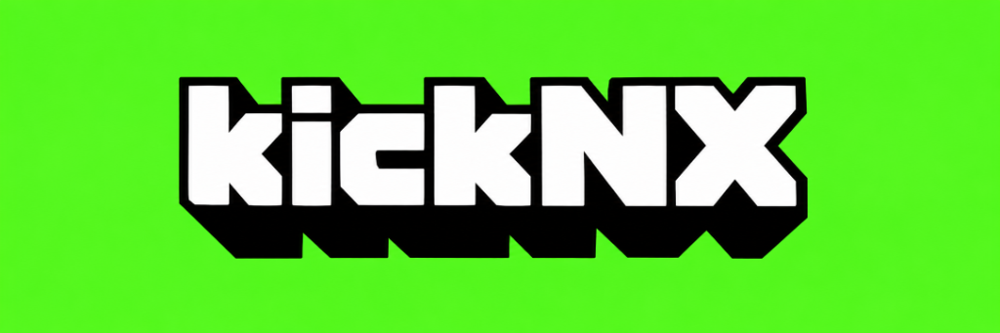

<p align="center">
  
</p>

<p align="center">
  <strong>A controller-first Kick client for Nintendo Switch homebrew.</strong>
</p>

<p align="center">
  <a href="https://github.com/j2k-lab/kickNX/releases/latest"></a>
  <a href="https://github.com/j2k-lab/kickNX/releases"></a>
  <a href="https://github.com/j2k-lab/kickNX/actions"></a>
  
  
  <a href="LICENSE"></a>
  <a href="https://kick.com"></a>
</p>

<p align="center">
  Created by <strong>j2k</strong>
</p>

## About

**kickNX** is an independent Kick client built specifically for Nintendo
Switch homebrew. It combines native playback, Kick browsing and interactive
chat in an interface designed around Joy-Con, Pro Controller and touchscreen
use in handheld, tabletop and television play.

Version 0.4.0 features channel follow and unfollow directly from streamer
profiles, custom 3D kickNX buffering indicator with lime text shimmer,
clickable user avatar navigation, Kick-green section divider lines and tabs,
Kick TV QR code pairing, Kick-styled playback controls with live stream uptime,
channel category navigation, bottom-sheet emote composer, real-time Pusher
chat, and Joy-Con portrait mode.

## Features

### Browse Kick

- Built-in Kick account sign-in
- Transparent 3D kickNX brand header logo on Home and About pages
- Interactive top-right profile avatar navigating directly to your channel
- Followed live channels row
- Popular streams, top categories and live search by channel or game
- Current viewer counts in live search results
- Controller-friendly horizontal rows with pagination
- Channel artwork, stream thumbnails and account information

### Channel pages

- Centered header presentation with prominent profile picture, stream title, live status, metadata, and action buttons
- Touch-friendly `< Back` button on the top left for quick touchscreen navigation
- Live/offline status, banner, profile artwork and description
- Direct channel follow and unfollow with real-time status detection and sync
- Current stream and category information
- Recent broadcasts and clips
- Direct live, VOD and clip playback

### Playback

- Native Kick live-stream, VOD and clip playback
- Custom 3D kickNX buffering indicator with animated lime-green letter shimmer and neon progress track
- Source and transcoded quality selection (1080p60 default)
- Embedded-player live resolution that avoids the generic commercial-break slate
- Software, hardware and Hybrid decoder modes
- Decoder changes apply immediately to the active live stream
- Hardened MPV/FFmpeg/NVTEGRA hardware-frame handling
- Fullscreen, docked-chat and overlay-chat layouts
- Live streams do not create unnecessary MPV watch-later files

### Portrait mode

- Automatic landscape and portrait detection from either attached Joy-Con
- Clockwise and counter-clockwise portrait orientations
- Manual orientation choices when sensor control is unavailable
- Rotated 720 x 1280 touch surface with corrected touch coordinates
- Stream, live chat, persistent message draft and inline keyboard on one screen
- Dedicated `Emotes` key on the portrait keyboard opening a portrait-proportioned Kick emoji composer with Recent and All tabs
- Touch keyboard/emote-sheet switching from the draft field or `< Keyboard` button
- Adjustable touch-keyboard haptic feedback

### Live chat

- Read and send Kick chat messages
- Kick username colors and formatted chat messages
- Global, channel, subscriber and exclusive emotes
- Static and animated Kick emotes
- Message composer with Recent, Channel and All emote tabs
- Touch-accessible Send button in the full composer
- Multi-line message wrapping
- Docked chat, full-height overlay and compact overlay
- Four-corner overlay placement and configurable width

### Controller-first interface

- D-pad and left-stick focus navigation with Kick bright green hover highlights
- OLED true black backgrounds across streamer profiles and About pages
- Right-stick scrolling on long pages
- Handheld, portrait and television-friendly layouts
- Dedicated About page with features, credits and complete release history

## Installation

1. Download the latest release from the
   [kickNX Releases page](https://github.com/j2k-lab/kickNX/releases/latest).
2. Extract the release so the SD card contains:

   ```text
   /switch/kickNX/kickNX.nro
   ```

3. Launch kickNX from the Nintendo Switch Homebrew Menu.
4. Complete the built-in Kick sign-in process.

No legacy configuration file is required. The client configures playback
settings automatically through the in-app settings menu.

## Updating

Replace the existing NRO in `/switch/kickNX/` with the newer release. OAuth,
chat, decoder, orientation and interface preferences remain under
`/config/KickNX/` and are not stored inside the executable.

## Decoder modes

- **Software:** compatibility mode using CPU video decoding.
- **Hardware - Experimental:** NVTEGRA decoding with the validated kickNX frame,
  reference and transfer guards.
- **Hybrid - Experimental:** starts in hardware and can use software recovery
  during a disruptive playback transition.

The embedded-player resolver prevents the generic Kick
commercial presentation from entering the player in current testing, greatly
reducing the discontinuities that previously stressed hardware decoding.

## Known limitations

- Some standard Unicode emoji characters may render as missing-glyph boxes.
- Subtitle tracks in Player Settings remain inactive until Kick updates their Amazon IVS backend to serve live transcode tracks (Kick's web player currently relies on client-side browser speech recognition).
- Kick may change its undocumented playback-token behavior without notice.
- Automatic portrait detection requires at least one compatible attached
  Joy-Con; manual orientation remains available from player settings.
- Hardware and Hybrid decoding remain experimental across untested stream formats.

## Building from source

See [BUILDING.md](BUILDING.md) for the supported MPV 0.36 package, guarded
FFmpeg 7.1/NVTEGRA recipe and Nintendo Switch build commands.

Quick build after dependencies are prepared:

```powershell
.\build-switch.ps1
```

The generated executable is:

```text
build_switch/KickNX.nro
```

The historical build-target filename retains `KickNX`; the visible application
name is **kickNX**.

## Project history

Major milestones:

- `0.1.0` - Initial native kickNX release ported from twiNX with guest browsing and controller navigation
- `0.2.0` - Real-time Pusher WebSocket live chat, Kick emotes, and streamer channel pages
- `0.3.0` - TV QR code login, live AWS IVS master playback, 60 FPS presentation, and fast VOD streaming
- `0.3.1` - Fast VOD/clip launch, active chatter counter, and WebVTT subtitle track selection
- `0.3.2` - Kick signature playback bar with live uptime, channel category navigation, and bottom sheet emote composer
- `0.4.0` - Channel follow/unfollow on streamer profiles, clickable user avatar, and Kick bright green UI theme

See [CHANGELOG.md](CHANGELOG.md) for the full release history.

## Credits

- **j2k** - kickNX creator and developer
- **Gemini** - AI co-development partner
- **twiNX contributors** - upstream client foundation
- **Switchfin contributors** - original Nintendo Switch UI/player/platform base
- **Borealis contributors** - controller-first UI framework
- **Twire contributors** - reference behavior for embedded-player resolution
- **mpv, FFmpeg, libcurl, LunaSVG, libnx and devkitPro contributors**

Full attribution is available in
[THIRD_PARTY_NOTICES.md](THIRD_PARTY_NOTICES.md).

## License

The combined kickNX project and its original kickNX-specific code are distributed
under **GPL-3.0-only**. Inherited and third-party files retain their original
licenses and copyright notices. See [LICENSE](LICENSE),
[LICENSES](LICENSES/) and [THIRD_PARTY_NOTICES.md](THIRD_PARTY_NOTICES.md).

## Disclaimer

kickNX is an independent, unofficial homebrew project. It is not affiliated
with, endorsed by or sponsored by Kick, Amazon or Nintendo. Product names and
trademarks belong to their respective owners.
